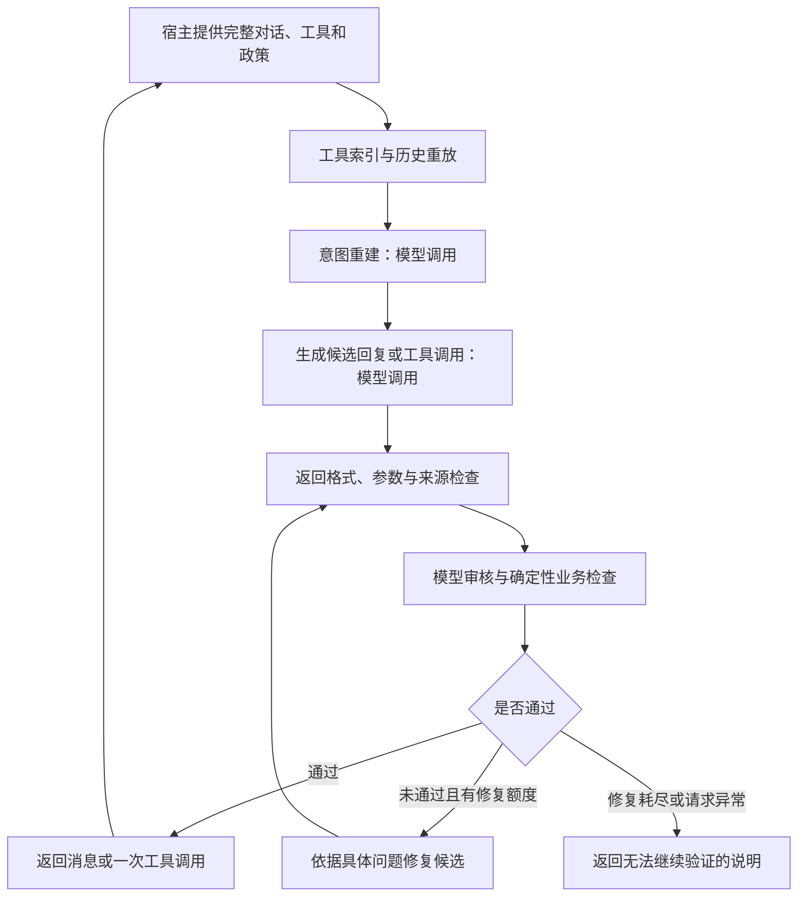

# MetaNovas Transactional Support Agent

面向事务型客服任务的 Python Agent。项目通过运行时提供的工具和业务政策处理查询、方案选择、费用计算、修改确认及批量任务，并在客户修改或撤销请求后更新执行计划。

**正式测评只需上传根目录的 `agent.py`。** 本地脚本、练习数据、测试与报告用于开发验证，不是 Agent 的运行依赖。

## 1. 项目概况

| 项目 | 说明 |
|---|---|
| 提交入口 | `respond(messages, tools, policy) -> dict` |
| 提交形式 | 单个 UTF-8 Python 文件，最大 150 KB |
| 状态管理 | 每次从完整对话重建，不依赖跨调用全局状态 |
| 模型访问 | 统一调用套件／平台提供的 `interview_sdk.chat()` |
| 工具执行 | Agent 返回一次调用，由宿主执行并追加结果 |
| 第三方包 | 无；使用 Python 标准库和提供的 SDK |
| 本地练习 | 虚构的设备预约场景及扩展用例 |

原始任务与评分要求见 [面试说明](docs/CANDIDATE_INSTRUCTIONS.md)。该说明保留原文；整理后的路径和运行方式以本 README 为准。

## 2. 主要能力

- **意图更新**：记录逐项目标、有效约束、来源消息、最近修改位置及完成／撤销／受阻状态；保留未受修改影响的其他目标。
- **写入授权**：将确认绑定到具体调用，检查提案与确认顺序、需求是否变化及授权是否已消耗。
- **批量处理**：首次写入前检查逐记录状态与处理计划，最终答复检查是否遗漏未完成事项。
- **证据判断**：检查参数来源、证据时效、候选资格、最优目标字段以及费用和余额计算。
- **客户沟通**：审核具体变更、实际结果、费用、资金来源及下一步，区分成功、失败、撤销和待处理事项。
- **异常控制**：限制修复次数；不盲目重复结果不确定的写入，可使用后续查询证据确认实际结果。

这些能力由模型语义判断与确定性代码检查共同实现，不等于对任意政策或自然语言输入的形式化保证。

## 3. 目录结构

```text
.
├── agent.py                         # 唯一需要上传的 Agent 文件
├── interview_sdk.py                 # 套件 SDK；正式环境由平台提供
├── requirements.txt                 # 无第三方依赖的说明
├── README.md
├── .gitignore
├── scripts/                         # 在项目根目录通过 python -m 启动
│   ├── practice_runner.py           # 基础预约练习
│   ├── diagnose_api.py              # API 与首轮决策脱敏诊断
│   ├── intent_change_runner.py      # 六种需求修改／撤销场景
│   └── requirements_suite.py        # 十五种扩展场景
├── data/
│   └── practice/
│       ├── practice_policy.md       # 本地练习政策
│       ├── practice_task.json       # 本地任务描述
│       └── practice_fixture.json    # 虚构数据库快照
├── tests/                           # 标准库 unittest 离线测试
│   └── test_*.py
├── docs/
│   ├── CANDIDATE_INSTRUCTIONS.md    # 原始面试说明
│   └── DEPENDENCIES.md              # 依赖与实现说明
├── reports/                         # 历史报告及新生成的测试结果
│   ├── intent_change_results.json
│   └── offline_test_results_2026-10-29.json
└── .cache/                          # 本地缓存，不参与提交
```

新增报告默认写入 `reports/`。IDE 设置保留在原位置；缓存、虚拟环境、IDE 配置、环境文件和生成的 JSON 报告已加入 `.gitignore`。

## 4. 环境与快速开始

### 4.1 运行环境

- Python **3.8+**，建议使用 **3.10+**。
- 已在 Python 3.8.6 上执行离线测试。
- 本地运行时，根目录需保留 `interview_sdk.py`。
- 离线测试不需要网络或密钥；真实模型练习需要可用的 API 服务、密钥和余额。

目前没有需要通过 pip 安装的第三方包。

以下命令均在**项目根目录**执行。不要再使用整理前的 `python practice_runner.py` 等根目录脚本命令。

### 4.2 先运行离线测试

```powershell
python --version
python -B -m unittest discover -s tests -t . -v
```

`-B` 用于避免生成新的字节码缓存，不影响测试行为。

如需单独运行证据与客户回复检查：

```powershell
python -B -m unittest -v tests.test_evidence_output
```

### 4.3 配置本地 API

PowerShell 示例使用套件中配置的 DeepSeek 模型标识：

```powershell
$env:INTERVIEW_PROVIDER = 'deepseek'
$env:INTERVIEW_API_KEY = 'YOUR_API_KEY'
$env:INTERVIEW_MODEL = 'deepseek-v4-flash'
```

请替换占位值，使用服务接受的 **model ID**，不要填写界面的模型显示名称。

| 环境变量 | 用途 | 必需性 |
|---|---|---|
| `INTERVIEW_PROVIDER` | 本地 provider：`openai` 或 `deepseek` | 默认 `openai` |
| `INTERVIEW_API_KEY` | 本地调用密钥 | 本地真实请求必需 |
| `INTERVIEW_MODEL` | 覆盖 SDK 默认模型 | 可选 |
| `MODEL_PROXY_SOCKET` | 正式平台模型代理入口 | 由平台配置 |

SDK 读取 `INTERVIEW_API_KEY`，不会自动读取 `OPENAI_API_KEY`、`DEEPSEEK_API_KEY` 或 `.env` 文件。正式门户支持的模型选择范围以平台说明为准；轻量本地 SDK 仅支持表中两个 provider。

`$env:` 设置仅影响当前 PowerShell 及其子进程。通过系统设置保存变量后，已有终端或其父程序可能需要重新启动。可以只检查是否存在，避免显示密钥：

```powershell
[bool]$env:INTERVIEW_API_KEY
```

不要把真实密钥写入源码、README、测试报告或共享日志。

### 4.4 诊断接口并运行基础练习

```powershell
# 一次模型请求，检查能否返回可用输出
python -m scripts.diagnose_api

# 检查基础任务的首轮决策与审核，不执行业务工具
python -m scripts.diagnose_api --agent

# 运行完整基础练习，可修改本次运行的内存数据库
python -m scripts.practice_runner
```

诊断脚本输出错误分类、HTTP 状态及响应元信息，不输出密钥、原始响应正文或私有推理。基础 runner 会打印虚构任务的业务轨迹；其进程退出码不能单独证明任务成功，需检查 `PRACTICE RESULT` 和调用顺序。

基础练习的可核对结果如下，数据来自本地 fixture，不是正式题答案：

| 项目 | 预期 |
|---|---|
| 原始要求 | 可用、平衡 XLR、续航至少 12 小时、重量最轻 |
| 合格最优设备 | `EQ-5C143A54`，365 克，续航 12 小时 |
| 费用变化 | 39.50 → 53.50，增加 14.00 |
| 项目信用余额 | 75.00 → 61.00 |
| 执行顺序 | 认证与读取 → 具体提案 → 用户确认 → 写入 → 实际结果汇报 |

## 5. 接口与架构

### 5.1 宿主调用契约

```python
def respond(messages: list[dict], tools: list[dict], policy: str) -> dict:
    ...
```

| 参数 | 内容 |
|---|---|
| `messages` | 截至本轮的完整对话，包含用户消息、助手提案、工具调用及结果 |
| `tools` | 运行时提供的函数工具定义及参数 schema |
| `policy` | 本轮适用的业务政策 |

返回一条客户消息：

```json
{"content": "客户可读的答复"}
```

或返回一次工具调用：

```json
{
  "tool_call": {
    "name": "read_reservation",
    "arguments": {"reservation_id": "RS-EXAMPLE"}
  }
}
```

两种形式不能同时返回。Agent 本身不执行业务工具；宿主执行返回的调用，并在下一次调用 `respond()` 时提供更新后的完整历史。

本地 DeepSeek 流程会保留 SDK 提供的 `_reasoning_content` 传输元数据，供 runner 回放；它不属于客户回复。按套件约定，正式代理在内部保存该信息，不向候选代码返回。

### 5.2 决策流程



正常路径有三次模型请求：意图重建、动作生成、动作审核。意图格式修复最多一次，动作修复最多一次，总计最多六次模型请求。**模型请求次数与业务工具调用次数不同：每轮最多返回一个业务工具调用。**

### 5.3 核心模块

所有正式运行逻辑均位于 `agent.py`：

| 函数组 | 职责 |
|---|---|
| `build_tool_catalog()` | 保留运行时工具定义，建立名称与参数索引 |
| `replay_history()` / `normalize_model_history()` | 关联调用与结果，处理标准、简写及旧式工具消息；保留未确定结果 |
| `reconstruct_intent()` / `validate_intent_state()` | 重建目标、约束、来源、最近更新、批量计划及写入授权 |
| `generate_candidate()` / `repair_candidate()` | 生成下一步，并按具体拒绝原因进行有限修复 |
| `validate_response_shape()` / `validate_tool_arguments()` | 检查返回契约及常见 JSON Schema 约束 |
| `check_argument_evidence()` | 检查疑似标识符／引用参数是否有来源 |
| `check_current_intent()` / `check_confirmation()` | 拦截已撤销目标、旧计划授权及已消耗确认 |
| `check_batch_evidence()` / `check_goal_completion()` | 检查批量首次写入前的证据和计划，以及最终回复中的未完成目标 |
| `check_evidence_judgment()` | 检查来源、时效、候选最优值、计算输入、算术及必要常量 |
| `check_customer_output()` | 检查客户答复是否直接、完整、准确并提供明确下一步 |
| `finalize_response()` | 输出契约允许的消息或工具调用 |

金额与计算使用 `Decimal`。算式正确但输入没有来源时也会被拒绝；最优选择需绑定实际字段，例如不能用价格冒充重量。历史数值可用于明确的历史比较或有依据的计算，当前状态声明则需使用有效证据。

## 6. 场景测试与报告

### 6.1 需求修改与撤销

```powershell
# 运行全部六个用例
python -m scripts.intent_change_runner

# 只测确认后、执行前修改需求
python -m scripts.intent_change_runner --scenario revise_after_confirmation

# 指定报告位置
python -m scripts.intent_change_runner --output reports/intent_change_custom.json
```

覆盖确认前修改、确认后修改、附加条件式确认，以及这三个时机对应的撤销／拒绝。测试从预置的认证、读取证据和原始提案开始，重点检查需求变化后的行为，不代表每次都从零验证完整认证过程。

修改用例将续航要求提高到 18 小时，预期选择 `EQ-779E9DD5`，增加费用 10.25，余额变为 64.75；撤销用例要求零写入且数据库不变。

默认报告：`reports/intent_change_results.json`。

### 6.2 扩展要求测试

```powershell
# 运行全部十五个用例
python -m scripts.requirements_suite

# 指定批量或结果不确定场景
python -m scripts.requirements_suite --scenario batch_mixed_status
python -m scripts.requirements_suite --scenario write_outcome_unknown

# 查看全部可选场景
python -m scripts.requirements_suite --help
```

| 类别 | 覆盖内容 |
|---|---|
| 身份与归属 | 正常认证、缺少身份信息、错误身份、其他客户记录 |
| 批量与授权 | 混合状态订单、共享余额、逐次确认、不同写工具的授权隔离 |
| 方案资格 | 无合格选项、资金不足、不可修改的状态 |
| 写入异常 | 明确拒绝、结果丢失后查询确认 |
| 政策与协议 | 必须升级处理、工具和参数改名、记录中的指令注入 |

扩展测试使用独立的虚构记录和显式附加政策；支持工单等能力是本地测试环境的扩展，不代表正式题的工具或规则。

默认报告：`reports/requirements_results.json`。扩展套件每完成一个场景就保存一次结果，便于长运行中断后查看已完成部分。

### 6.3 结果解释

| 状态 | 含义 |
|---|---|
| `PASS` | 自动检查的工具行为和数据库状态符合预期 |
| `FAIL` | 观察到明确的违规调用、错误状态或任务遗漏 |
| `INCONCLUSIVE` | 因回复措辞、兜底答复或步数限制，自动检查无法确认 |
| `ERROR` | 模型请求或执行发生异常 |
| `BLOCKED` | 当前进程缺少调用配置，未开始真实模型测试 |

`communication_review_required: true` 表示仍需人工核对客户回复。`PASS` 不等于正式评分满分，`INCONCLUSIVE` 也不应直接解释为已发生违规。真实模型测试会产生模型 API 请求并消耗相应额度。

### 6.4 当前验证记录

2026-10-29 的 [离线报告](reports/offline_test_results_2026-10-29.json) 记录：

- 124 项离线测试通过，0 失败、0 错误。
- 包含只保留 `agent.py` 和模拟平台 SDK 的独立目录运行测试。
- Agent 文件为 77,895 字节，低于 150 KB 限制。
- 报告绑定源码 SHA-256；离线模型响应使用 mock。
- 该记录未执行当前版本的真实模型请求，不代表正式题成绩。

目录整理后已重新运行 124 项离线测试并通过，`agent.py` 哈希与该报告一致。保留的 `intent_change_results.json` 是一次历史真实模型运行结果，未绑定当前源码哈希，不能代替当前版本的重新验收。

## 7. 正式提交

1. 使用项目根目录的 `agent.py`，保持 UTF-8 编码和规定的 `respond()` 签名。
2. 本地完成所需验证后，在门户中**只上传 `agent.py`**。
3. 不需要上传 `scripts/`、`tests/`、`data/`、`reports/`、README 或依赖说明。
4. 正式环境使用平台提供的 `interview_sdk` 和运行时数据／政策；Agent 不读取本地 fixture、报告或环境文件。

评分规则与实现关注点对应如下：

| 评分维度 | 权重 | 实现关注点 |
|---|---:|---|
| 意图识别与状态更新 | 20% | 来源可追踪的目标账本、最新请求、修改与撤销 |
| 工具选择与精确参数 | 20% | 动态 schema、参数检查、引用来源 |
| 规划、顺序与完整执行 | 20% | 依赖顺序、批量完整计划、剩余目标检查 |
| 基于证据的信息判断 | 15% | 当前证据、全部约束、最优选择与费用核对 |
| 客户输出清晰完整 | 10% | 具体提案、实际结果、金额／资金来源及下一步 |
| 调用纪律与政策安全 | 15% | 单次工具调用、认证、逐次授权及政策审核 |

权重来自原始说明，最终得分只能由正式测评确定。

## 8. 常见问题与实现边界

| 现象 | 排查方式 |
|---|---|
| `missing_api_key` / `BLOCKED` | 在启动 Python 的同一终端检查 `INTERVIEW_API_KEY`；不要直接打印密钥 |
| HTTP 401 | 核对当前 provider、密钥是否有效及是否属于对应服务 |
| HTTP 402 | DeepSeek 通常表示 API 账户余额不足，检查当前密钥所属账户 |
| HTTP 400／404 | 检查 model ID、请求格式、服务入口及该模型支持的参数 |
| `finish_reason: length` | 模型输出预算耗尽，不能把空输出或不完整审核视为通过 |
| Agent 只返回无法继续验证 | 先运行 `scripts.diagnose_api`，再用 `--agent` 区分接口异常与审核问题 |
| `ModuleNotFoundError: scripts` | 确认位于项目根目录，并使用 `python -m scripts.<模块名>` |
| 仅某些场景 `INCONCLUSIVE` | 阅读报告中的 `reason`、检查项和 `trace`，人工核对措辞及证据 |

当前实现还有以下边界：

- 自然语言意图、工具副作用、政策适用性和回复质量仍依赖模型判断；代码检查不能替代完整语义理解。
- 本地 schema 校验覆盖常用类型、对象／数组、枚举、组合条件与本地引用，并非完整 JSON Schema 实现。
- SDK 单次输出预算上限为 4096 tokens；长对话、多目标和推理输出可能增加截断、耗时及费用。
- 本地 SDK 的模型请求参数是固定构造的；更换模型时需根据诊断确认参数兼容性，不能假定所有兼容接口模型都支持同一组选项。
- 基础 runner 的自动确认逻辑较轻量；应结合严格场景套件和完整轨迹判断授权、最优选择及完成情况。
- 本地数据不含正式题答案，所有扩展场景仅用于练习和回归验证。

更详细的函数与依赖说明见 [DEPENDENCIES.md](docs/DEPENDENCIES.md)。
